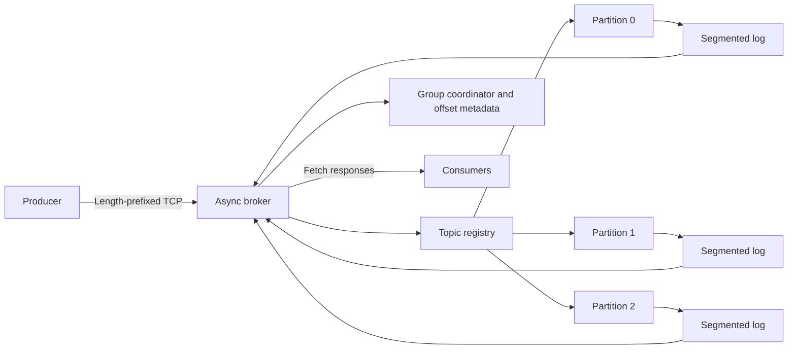

# Event Streaming Platform

A Kafka-inspired event streaming platform built from scratch in Python.

This project is an educational implementation of event-streaming concepts and
is not protocol-compatible with Apache Kafka. It implements its own storage
and TCP protocol and uses no external messaging infrastructure.

## Features

- Async TCP broker with bounded frames, connection limits, and per-partition writes
- Topics, partitions, arbitrary binary keys, values, and headers
- Append-only binary logs, CRC32, segment rollover, and sparse offset indexes
- Deterministic SHA-256 key partitioning and keyless round-robin selection
- Connection-reusing producer with single-frame batch production
- Consumer groups with UUID members, heartbeats, assignments, and generation fencing
- Atomic persistent next-offset commits and independent group consumption
- Bounded batch fetch and broker long polling
- Time and optional size retention of closed segments
- Incomplete trailing-write recovery and automatic index rebuilding
- CLI administration, storage inspection, safe dumps, metrics, and local benchmarks
- Offline unit and TCP integration tests

## Architecture



One broker owns its data directory using an OS file lock. The event loop manages
networking and group membership. Four dedicated disk worker threads perform
append/fetch/retention work. Per-partition asyncio locks serialize these operations;
storage also has a thread lock for standalone use. Different partitions can progress
concurrently. No partition lock is held during network drain or long-poll waiting.

## Storage Architecture

```text
broker-data/
  .broker.lock
  topics/orders/
    topic.json
    partition-0000/
      00000000000000000000.log
      00000000000000000000.index
      00000000000000000128.log
      00000000000000000128.index
    partition-0001/...
  consumer-groups/analytics.json
```

Each segment filename is its decimal base offset, padded to 20 digits. Segments
roll before the next append would exceed the configured size. A single record
larger than the segment target is allowed in its own segment, subject to the
separate maximum encoded record limit (1 MiB by default).

Binary records use network byte order:

| Field | Encoding |
|---|---|
| Magic | 4 bytes, `ESTR` |
| Version | uint8, currently 1 |
| Body length | uint32 |
| CRC32 | uint32, over the complete body |
| Offset | uint64 |
| Timestamp | uint64, Unix milliseconds |
| Key length | int32, -1 means null; 0 means empty key |
| Value length | uint32 |
| Header count | uint16 |
| Key and value | Raw bytes |
| Each header | uint16 UTF-8 name length, uint32 value length, name bytes, value bytes |

An index entry is two uint64 values: absolute offset and byte position. Every 128th
record is indexed by default. Fetch uses binary search over segment base offsets,
then binary search over the sparse index, then a short sequential scan. Indexes
are derived data and rebuilt on startup, even if missing or corrupt. Startup scans
all segments to validate CRCs and contiguous offsets; fetch does not scan from zero.

## Topics and Partitions

Ordering is guaranteed only within one partition. There is no global topic order.
Offsets are assigned by the broker and increase independently in each partition.
Reading does not remove records. Names are limited to 128 ASCII letters, digits,
dots, underscores, and hyphens, starting with a letter or digit. Paths are checked
for containment; topic deletion rejects symbolic links or escaped descendants.
Keep broker storage exclusively broker managed; concurrent local filesystem edits
are unsupported.

## Message Keys

For a non-null key, partition = big-endian integer SHA-256(key) modulo partition
count. This is stable across interpreter processes. Empty bytes are a real key.
Keyless records use a broker-owned round-robin counter; the counter resets at
restart. `--partition` overrides partitioning and is validated. Partition counts
are fixed for a topic's lifetime.

## Offsets

- **Log start:** earliest retained offset, inclusive.
- **Log end:** next offset to append, exclusive.
- **Committed offset:** next offset the group should consume, never the last processed offset.
- **Lag:** max(0, log end - committed next offset). No commit means unknown lag (`null`).

For example, processing record 3 and committing it stores 4. New consumers start
at latest unless `--from-beginning` is used. Existing commits take precedence.
Positions without a commit are reset on rebalance using the selected start policy.
If a committed offset falls behind retention, fetch raises `OFFSET_OUT_OF_RANGE`
with earliest/latest offsets; it does not silently skip data. Explicit operator
intervention or a new group is required. `commit()` commits all fetched positions:
call it only after processing the complete returned batch. `commit(record)` commits
that partition through the record; process each partition in order.

## Consumer Groups

The broker coordinates one topic subscription per member. UUID member IDs are
sorted, and each topic's partitions are assigned round-robin among its subscribers.
A partition has one owner in each stable group; different groups independently
read the same log. Joining, leaving, and heartbeat expiry trigger reassignment.

Each rebalance increments a persisted generation ID. Commits and group fetches
carry member identity, generation, and partition; stale generations and nonowners
are rejected. Generation advances on broker restart, and membership is ephemeral.
Clients must be recreated after a broker restart or membership expiry. The Python
consumer runs a background heartbeat connection, with heartbeats every third of
the broker session timeout (default 10 seconds). Generation changes discard local
uncommitted positions. Records fetched before a client-observed rebalance cannot
be committed through the record API. Heartbeats maintain ownership even during
slow application processing; there is no maximum processing-interval watchdog.

Run two terminals with the same group to divide partitions:

```sh
event-stream consume orders --group analytics --from-beginning
event-stream consume orders --group analytics --from-beginning
event-stream group describe analytics
```

Assignment changes do not cancel application code already processing a record.
Fencing protects broker fetch/commit ownership, not external side effects.

## Delivery Semantics

Commit after successful processing for at-least-once processing of retained records.
A crash between processing and commit can repeat a record; handlers should be
idempotent. There are no transactions or exactly-once guarantees. Batch production
is sequential and can partially succeed if a later record fails. Batch requests
contain 1–1000 records and must fit one 8 MiB frame.

`acks="1"` (default) acknowledges after write and flush to the OS file buffer.
`acks="fsync"` additionally calls `os.fsync` before acknowledgement. These modes
survive normal restart; OS-buffer mode does not promise survival of power failure.
Filesystem/device behavior still matters. Atomic JSON metadata uses a temporary
file, file fsync, and `os.replace`; directory entries are not separately fsynced,
so full power-loss-safe directory creation is not promised.

Producers reuse connections. A failed connection is closed and the next explicit
request reconnects. Ambiguous sends are never automatically retried. If the ACK
is lost, the record may exist; retrying manually can duplicate it.

## Network Protocol

Each frame is a four-byte unsigned big-endian payload length followed by UTF-8
JSON. Zero-length and >8 MiB frames are rejected before payload allocation. Use
exact reads: packet boundaries have no semantic significance. Binary keys, values,
and header values use standard base64 (roughly 33% expansion plus JSON overhead).

```json
{"version":1,"request_id":"unique-id","type":"PRODUCE","payload":{"topic":"orders","key":null,"value":"aGVsbG8=","acks":"1"}}
```

```json
{"version":1,"request_id":"unique-id","ok":true,"data":{"topic":"orders","partition":0,"offset":0,"timestamp_ms":1234}}
```

Errors have `ok:false` and `error:{"code":"...","message":"..."}`. Stable codes
include `INVALID_REQUEST`, `UNSUPPORTED_VERSION`, `UNKNOWN_TOPIC`,
`UNKNOWN_PARTITION`, `TOPIC_EXISTS`, `MESSAGE_TOO_LARGE`, `OFFSET_OUT_OF_RANGE`,
`GROUP_NOT_FOUND`, `UNKNOWN_MEMBER`, `ILLEGAL_GENERATION`, `NOT_PARTITION_OWNER`,
and `INTERNAL_ERROR`.

Operations: `PING`, `METADATA`, `CREATE_TOPIC`, `DELETE_TOPIC`, `LIST_TOPICS`,
`DESCRIBE_TOPIC`, `PRODUCE`, `PRODUCE_BATCH`, `FETCH`, `JOIN_GROUP`, `HEARTBEAT`,
`LEAVE_GROUP`, `COMMIT_OFFSET`, `FETCH_OFFSETS`, `LIST_GROUPS`, `DESCRIBE_GROUP`,
`BROKER_INFO`, `METRICS`, `INSPECT`, `DUMP`. Admin operations have no authentication;
the broker binds to loopback by default.

`FETCH` specifies topic, partition, inclusive offset, max_records (1–10000),
max_bytes (1–4 MiB of encoded log records), and max_wait_ms (0–10000). End offset
returns an empty result. A first record too large for the requested byte budget
returns `MESSAGE_TOO_LARGE`; raise the budget. Long polls wake on append or timeout.
The synchronous group consumer uses bounded 50 ms polling across assigned
partitions; direct protocol clients can use broker long polling.

## Backpressure

At most 128 admitted connections each process one request at a time. Each frame,
batch, fetch response, and disk request is bounded. Stream readers use an 8 MiB
high-water limit; writers await `drain` with a 10-second timeout. Incomplete/idle
requests time out after 30 seconds. Connection limits bound pending work submitted
to the disk executor, whose four workers operate across partitions. These limits
are educational defaults rather than a production memory quota.

## Crash Recovery

Startup verifies record envelopes, lengths, CRCs, and contiguous offsets. An
incomplete final record in the active segment is truncated at its start; earlier
valid records are preserved. Complete records with a bad CRC, malformed envelopes,
and corruption in closed segments fail startup without destructive repair. Indexes
are rebuilt from validated log data. This conservative policy avoids treating
arbitrary media corruption as a disposable tail.

## Retention

The periodic task removes only oldest closed segments whose newest record is
older than the configured duration (default 168 hours), or until the partition's
size is within its optional byte target. Active segments are always kept, even
if they alone exceed the byte target. Size retention is per partition. Retention
ignores consumer progress; slow groups can fall behind the retained start offset.
It never rewrites retained records. Resolved-path checks constrain deletions to
managed storage. Retention is segment-granular rather than record-granular.

## Installation

Python 3.12 or newer is required.

```sh
python -m venv .venv
# Windows PowerShell:
.venv\Scripts\Activate.ps1
# Linux/macOS:
source .venv/bin/activate
pip install -e ".[dev]"
event-stream --help
event-stream --version
```

Runtime dependency: Typer provides the CLI (and brings its own display/parsing
dependencies). Storage, TCP, clients, metrics, and benchmarks use the standard
library. Development dependencies are pytest, pytest-asyncio, and Ruff.

## Quick Start

```sh
event-stream broker start --data-dir ./broker-data
# Another terminal:
event-stream topic create orders --partitions 3
event-stream produce orders --key user-42 --value '{"order":123}' --acks fsync
event-stream consume orders --group analytics --from-beginning
```

Use Ctrl+C to stop the broker gracefully. SIGTERM is also handled. Existing
operations finish before the data-directory lock is released.

## CLI Reference

All client commands accept `--host` (127.0.0.1) and `--port` (9092).
Administrative output is machine-readable JSON containing actual broker data.
Sizes `KB`, `MB`, and `GB` consistently mean powers of 1024; plain integers mean bytes.

| Command | Additional flags |
|---|---|
| `broker start` | `--data-dir`, `--segment-size`, `--max-record-size`, `--index-interval`, `--retention-hours`, `--retention-interval`, `--session-timeout`, `--log-level` |
| `broker info`, `broker metrics` | none |
| `topic create NAME` | `--partitions`, `--retention-hours`, `--retention-bytes` |
| `topic list`, `topic describe NAME` | none |
| `topic delete NAME` | `--yes` bypasses interactive confirmation |
| `produce TOPIC` | `--value`, `--key`, `--partition`, `--stdin`, `--acks` |
| `consume TOPIC` | `--group`, `--from-beginning`, `--limit`, `--max-records`, `--max-bytes` |
| `group list`, `group describe ID` | none |
| `storage inspect TOPIC` | `--partition` |
| `storage dump TOPIC` | `--partition`, `--offset`, `--limit`, `--show-values` |
| `benchmark produce` | `--topic`, `--messages`, `--message-size`, `--batch-size` |
| `benchmark consume` | `--topic`, `--messages`, `--batch-size` |

CLI consume commits each record after writing it to stdout; use the Python API
for application-controlled commits. `--stdin` reads one bounded line at a time:

```sh
cat events.jsonl | event-stream produce orders --stdin
```

## Python Client

```python
from event_streaming import Producer, Consumer

with Producer("127.0.0.1", 9092) as producer:
    metadata = producer.send("orders", b'{"order_id":123}', key=b"user-42")
    print(metadata.partition, metadata.offset)
    producer.send_batch("orders", [b"one", {"value": b"two", "key": b"k"}])

with Consumer(topic="orders", group_id="analytics", from_beginning=True) as consumer:
    for record in consumer:
        print(record.value)
        consumer.commit(record)
```

Consumers and producers are context managers. A single consumer should be driven
by one application thread; its heartbeat thread is internal.

## Inspect Storage

```sh
event-stream topic describe orders
event-stream group describe analytics
event-stream storage inspect orders --partition 0
event-stream storage dump orders --partition 0 --limit 20
event-stream storage dump orders --partition 0 --limit 20 --show-values
```

Inspection reports actual segment base/last offsets, byte sizes, record counts,
and sparse-index entry counts. Dump hides message bodies by default; explicit
value dumps use base64. Inspect/dump operate through the broker to coordinate
with active writes and retention.

## Metrics

`event-stream broker metrics` exposes produced/fetched message and value-byte
counters, produce/fetch error counters, active connections, topic/partition
gauges, and produce/fetch latency sum/count in seconds. Counters reset at restart;
fetch counters include replayed deliveries. No HTTP metrics/health endpoint is
implemented. `PING` reports liveness; `broker info` includes uptime and storage size.

## Benchmarking

```sh
event-stream topic create benchmark --partitions 3
event-stream benchmark produce --topic benchmark --messages 1000 --message-size 256 --batch-size 100
event-stream benchmark consume --topic benchmark --messages 1000 --batch-size 100
```

Benchmarks allow only local host addresses, use real TCP requests, and report
actual messages/sec, MiB/sec, mean and P50/P95/P99 request latency. Produce samples
are per batch; consume samples are per fetch, not per-record processing latency.
Percentiles use linear interpolation of sorted measured samples. Consumer runs
read a snapshot of existing start/end offsets without altering group commits and
can return fewer records if fewer exist. Default runs are small; hardware,
filesystem, durability mode, and batch size substantially affect results.

## Testing

```sh
python -m pytest
```

Tests use `tmp_path`, dynamic loopback ports, and no external services. In a
restricted environment whose default temp directory is inaccessible:

```sh
python -m pytest --basetemp=.test-tmp
```

Tests cover encoding, CRC corruption, tail recovery, index rebuild, segment
boundaries, retention ranges, storage locking, binary-safe networking, fragmented
and coalesced TCP frames, malformed clients, oversized records, concurrent
producers, group ownership, stale generations, heartbeat expiry, independent
groups, committed-offset restart, CLI help/version, and small real benchmarks.

See [the verification record](docs/VERIFICATION.md) for commands actually run,
results, measured benchmark conditions, and publication instructions. A separate
smoke run can be reproduced with `python scripts/verify.py`.

## Development

```sh
pip install -e ".[dev]"
ruff check .
ruff format --check .
```

## Project Structure

```text
src/event_streaming/
  models.py       # immutable public records and stable exceptions
  storage.py      # binary codec, segments, sparse indexes, partition logs
  registry.py     # topic metadata and data-directory ownership
  groups.py       # membership, assignment, generation fencing, commits
  protocol.py     # TCP framing and binary-safe JSON codec
  broker.py       # async request server, maintenance, metrics
  client.py       # producer, consumer, reusable synchronous connection
  cli.py          # administration and streaming commands
  benchmark.py    # measured local workloads and percentiles
tests/            # storage, network, client, group, and CLI tests
examples/         # small producer and consumer programs
scripts/verify.py # small reproducible benchmark and restart smoke check
```

## What I Learned

This implementation makes the tradeoffs behind asyncio, TCP framing, append-only
logs, explicit binary formats, CRCs, sparse indexes, partitioning, persistent
offsets, group generations, heartbeats, backpressure, recovery, and benchmarking
visible in focused modules. The central lesson is that acknowledgement, commit,
and processing are distinct events; failures between them determine delivery
semantics. Single-broker ownership is much simpler than distributed consensus.

## Limitations

- Educational/portfolio use; not Kafka protocol compatible
- Single broker; no replication, failover, or automatic distributed consensus
- No exactly-once guarantees, idempotent producer, or transactions
- No production authentication, TLS, ACLs, or quotas
- Group rebalances fence broker operations, not application side effects
- Recreate consumers after broker restart or heartbeat expiry
- Synchronous metadata persistence can briefly block the event loop
- Startup validates all logs; startup time grows with retained data
- Memory-resident sparse indexes; no compression, compaction, or zero-copy transfer
- CRC corruption fails closed; only incomplete active tails are automatically repaired
- No separately fsynced directory entries or guarantee against arbitrary media failure
- Local filesystem mutation by other processes is unsupported

## Future Improvements

Replication and leader/follower partitions, Raft-based metadata consensus,
idempotent producers, transactions, compression, TLS, authentication, ACLs,
schema registry, log compaction, memory-mapped indexes, zero-copy reads, and a
web dashboard are future work. Replication is intentionally not implemented.

## Suggested Commit Sequence

For ongoing development, keep commits focused on actual changes. The following
is a suggested breakdown of the implementation, not a fabricated commit history:

1. Initial Python project setup
2. Add binary record codec, CRC, and protocol framing
3. Implement append-only segments, sparse indexes, and recovery
4. Add topic metadata and partition management
5. Implement async TCP broker and bounded fetch/produce
6. Add producer partitioning, batching, and consumer offset commits
7. Add group membership, assignment, heartbeats, and generation fencing
8. Add long polling, backpressure, retention, and graceful shutdown
9. Add storage inspection, metrics, and benchmarks
10. Add integration tests, examples, and documentation

This project has its own local repository. Review the local `.gitignore` and
`git status` before committing. Never stage an unrelated parent folder.
